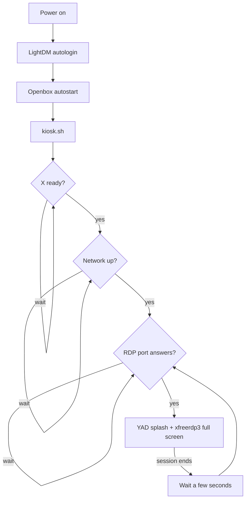

# rpi-rdp-kiosk

> Low-cost thin client for Raspberry Pi 5: it boots straight into a full-screen RDP session against a Windows server, reconnects automatically, and is deployed from a clone-ready "golden image" with a short setup wizard.

**Resumen en español:** cliente liviano sobre Raspberry Pi 5 que arranca directamente en una sesión RDP a pantalla completa contra un servidor Windows, se reconecta solo y se despliega desde una imagen base ("Golden Image") con un asistente de configuración. Pensado para que el usuario final nunca tenga que interactuar con Linux.

<!-- TODO: add a photo of a deployed terminal or a screenshot of the Conky overlay / agregar foto o captura -->

---

## Why

Many workstations only need to reach a remote Windows application. A full PC is expensive to buy, patch and support for that job. This project replaces it with a small, controlled terminal that:

1. powers on,
2. starts a minimal graphical session automatically,
3. connects to the remote server, and
4. keeps the session full-screen and reconnects if it drops.

The end user does not need to touch Linux at any point.

## Stack

| Layer | Component |
|---|---|
| Operating system | DietPi (arm64), based on Debian 13 "Trixie" |
| Session start | LightDM with automatic login |
| Desktop | Openbox (minimal) |
| RDP client | FreeRDP 3 (`xfreerdp3`) |
| Launcher | `kiosk.sh`: waits for X, network and server, then runs FreeRDP and retries |
| Start-up splash | YAD |
| Support overlay | Conky (hostname, IP, server, connection state) |
| Background | feh |
| Remote assistance | VNC |
| Provisioning | `setup.sh` (initial personalization wizard) |

**Reference hardware:** Raspberry Pi 5 (2 GB RAM), 16 GB microSD, HDMI monitor, USB keyboard and mouse, Ethernet.

## How it works



Because `kiosk.sh` waits for each dependency, the terminal can boot even when the network or the remote server is not available yet.

## Golden Image workflow

The **golden image** is a base installation with all the common software and configuration. It contains **no** per-device data: no final hostname, no credentials, no device-specific settings. Those are loaded once per device with `setup.sh`.

1. Flash the golden `.img` onto a microSD card (Raspberry Pi Imager with "custom image", or Win32 Disk Imager). **Double-check the target drive before writing.**
2. Insert the card, connect Ethernet and the monitor, and power on.
3. Connect over SSH and run the wizard:
   ```bash
   sudo /opt/rpi-rds/bin/setup.sh
   ```
4. Verify (see below) and install the device in its final place.

> Images are **not** stored in this repository. They are published separately because they may contain site-specific assets. See the roadmap for a reproducible build that replaces the shared image.

### What the wizard asks for

- Hostname.
- RDP server (IP or name). The port is fixed at 3389 and is not asked.
- Windows domain.
- RDP username and password (hidden input).

It updates `/etc/hostname` and `/etc/hosts`. Network configuration is **not** handled by the wizard: the device uses the network of the site where it is installed.

## Configuration

`/opt/rpi-rds/config/rdp.conf` (general settings, safe to share; example values):

```ini
RDP_BIN=/usr/bin/xfreerdp3
RDP_SERVER=192.0.2.10        # example address (documentation range)
RDP_PORT=3389
DOMAIN=example.local
FULLSCREEN=yes
CERT_IGNORE=yes              # see "Security notes"
DYNAMIC_RESOLUTION=yes
CLIPBOARD=yes
AUDIO=no
PRINTER=no
USB=yes
DRIVES=no
AUTOLOGIN=yes
```

`/opt/rpi-rds/config/rdp.env` (credentials, kept separate and **empty** in the golden image):

```ini
USERNAME=
PASSWORD=
```

Installed layout on the device:

```
/opt/rpi-rds/
├── assets/        # wallpaper
├── bin/           # kiosk.sh, setup.sh, ip_overlay.sh
├── config/        # rdp.conf, rdp.env, conky/conky.conf
├── logs/          # kiosk.log
└── docs/
```

## Verification

After running the wizard, over SSH:

```bash
hostname && cat /etc/hostname /etc/hosts
cat /opt/rpi-rds/config/rdp.conf
ps -ef | egrep 'lightdm|Xorg|openbox|kiosk|xfreerdp' | grep -v grep
loginctl      # a graphical session must exist for the kiosk user
```

## Troubleshooting

| Symptom | What to check |
|---|---|
| Boots but no graphical session | `systemctl status lightdm` · `journalctl -u lightdm -b --no-pager -n 100` · `ps -ef \| egrep 'lightdm\|Xorg\|openbox'` |
| FreeRDP does not connect | Review `rdp.conf` and `rdp.env`; `ping <server>`; test the port: `timeout 2 bash -c '</dev/tcp/<server>/3389'`; `tail -100 /opt/rpi-rds/logs/kiosk.log` |
| Splash does not appear | `command -v yad` · `bash -n /opt/rpi-rds/bin/kiosk.sh` |
| Conky does not appear | `command -v conky` · run it inside the graphical session |
| `feh` says "Can't open X display" | Normal over SSH. Test from the session: `DISPLAY=:0 XAUTHORITY=<home>/.Xauthority feh --bg-fill <wallpaper>` |
| Overlay script not executable | `chmod +x /opt/rpi-rds/bin/ip_overlay.sh` |
| `rdp.env` unreadable | Check owner, group and permissions of the file |

Restarting `lightdm` reloads `kiosk.sh` without dropping an active VNC session: `systemctl restart lightdm`.

## Delivery checklist

- [ ] Image flashed correctly; hostname and `/etc/hosts` correct.
- [ ] Server, domain and credentials configured.
- [ ] Graphical session starts automatically; FreeRDP connects and runs full screen.
- [ ] Keyboard, mouse and required USB peripherals work.
- [ ] Conky shows hostname and IP; VNC tested.
- [ ] Reboot and automatic reconnection tested.
- [ ] Device labelled and its hostname, location and IP recorded.

## Security notes and known limitations

These are the current limitations of the reference configuration, together with recommended hardening:

- **Certificate validation is disabled** (`CERT_IGNORE=yes`). This makes the connection vulnerable to man-in-the-middle attacks. Recommended: install the server's CA certificate on the device and enable validation.
- **Credentials live in a plain-text file** (`rdp.env`). Restrict it to its owner (`chmod 600`), never put real credentials in the image, and consider alternatives such as an RD Gateway or prompting at login.
- **VNC and SSH are management tools.** Keep them reachable only from a management network or VPN, use strong authentication, and prefer SSH keys over passwords.
- Good practice already followed: no credentials in the golden image, one official image, changes tested first on a lab device, and configuration backed up before edits.

## Roadmap

- [ ] Reproducible build (script or Ansible) to replace distributing a shared `.img`.
- [ ] Enable certificate validation with a CA certificate.
- [ ] Per-device configuration from a single declarative file.
- [ ] `shellcheck` on the scripts, with CI.
- [ ] Basic status reporting (version, uptime, connection state).

## Author

Designed, built and documented by Fabricio León.

## License

<!-- TODO: choose a license (MIT or GPL-3.0) and add the LICENSE file / elegir licencia y agregar el archivo LICENSE -->
